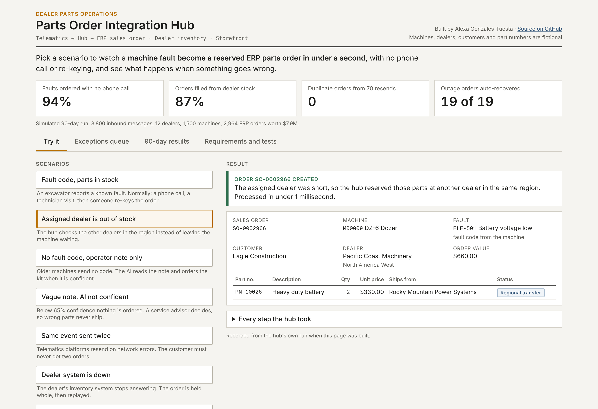
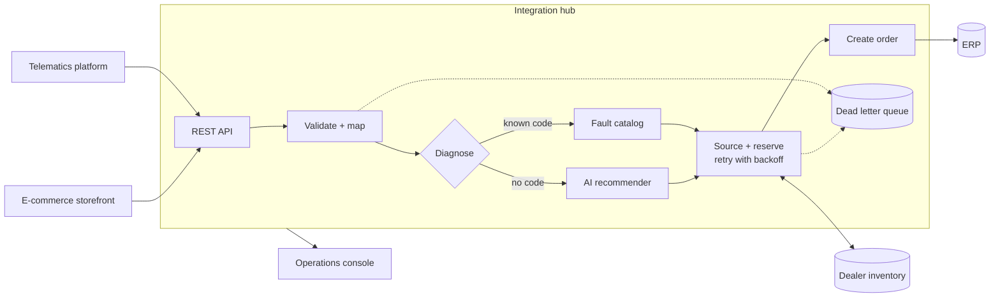

# Connected Equipment Parts Integration Hub


**Created by Alexa Gonzales Tuesta** | [LinkedIn](https://www.linkedin.com/in/alexa-gonzales-tuesta/)

### [Try the live console](https://alexagonzalestuesta.github.io/equipment-parts-integration-hub/)

Loads in about a second, no sign-up. Pick one of seven scenarios and watch a machine fault become a reserved ERP parts order, or see how the hub handles a stock-out, a vague operator note, a resend, a dealer system outage and a stale storefront price. Fictional data only.



Every result in the live console is the hub's real output: on each push, GitHub Actions runs the 90-day simulation, the tests and `site/build_site.py`, which sends each scenario through the hub (`app/demo.py`) and publishes what it produced. To send your own events, run the interactive console or the REST API locally (see [Run it](#run-it)).

An integration hub that connects four enterprise systems found at any heavy equipment manufacturer and its dealer
network (telematics, ERP order management, dealer inventory, and an e-commerce storefront), so a machine fault or a
web order becomes a correct ERP sales order in milliseconds, with the nearest dealer stock reserved.

## The business problem

When a machine breaks down on a job site, the fault appears in the telematics system, but the parts order waits for
a phone call, a technician visit, a diagnosis and someone re-keying the order into the ERP. Online orders come in
through a separate system and are re-keyed too. The result is idle machines, wrong parts, duplicate orders, and
no single place to see why an order is stuck.

## What the hub does

| Capability | How |
|---|---|
| Receives fault events and web orders | REST API (FastAPI) with an OpenAPI contract |
| Validates every message | Canonical data model with type and pattern rules (Pydantic) |
| Diagnoses the fault | Fault catalog rules, or an **AI model** that reads the operator's note when no fault code is sent |
| Keeps a human in the loop | AI predictions under 65% confidence go to a service advisor queue instead of ordering |
| Finds the parts | Assigned dealer first, then other dealers in the region, otherwise backorder |
| Survives outages | Retries with exponential backoff, all-or-nothing transactions, dead letter queue, replay |
| Never double-orders | Idempotency check plus a database UNIQUE constraint |
| Can be supported | Full audit trail per message, troubleshooting API, operations console, runbook |

## Results on a simulated 90-day run (3,800 messages)

| Measure | Result |
|---|---|
| ERP orders created automatically | 2,964 |
| Actionable fault events ordered with no person involved | 94% |
| Processing time per message (95th percentile) | under 2 ms (target under 50 ms) |
| Duplicate resends blocked | 70, with 0 duplicate orders |
| Messages caught by two dealer system outages | 19, all recovered by replay with no manual work |
| AI: precision of auto-orders on held-out notes | 87% (top-3 accuracy 96%) |
| Requirements verified by automated tests | 22 of 22 (43 tests) |

All data is synthetic and generated by `hub/simulate.py`. Systems, dealers, customers and part numbers are fictional.

## Architecture



## Project documents (the analyst work)

| Document | What it shows |
|---|---|
| [01 Business requirements](docs/01_business_requirements.md) | Problem, stakeholders, KPIs, 15 functional and 7 non-functional requirements, user stories with acceptance criteria |
| [02 Solution design](docs/02_solution_design.md) | Architecture, data model, sequence diagram, API contract, error handling matrix, design decisions, security |
| [03 Process flows](docs/03_process_flows.md) | Current state vs. future state, web order flow, support flow |
| [04 System test plan](docs/04_system_test_plan.md) | Test levels, techniques, entry and exit criteria, defect log |
| [05 Requirements traceability matrix](docs/05_requirements_traceability.md) | Every requirement linked to the tests that verify it (generated) |
| [06 Troubleshooting runbook](docs/06_troubleshooting_runbook.md) | How IT support diagnoses and fixes each failure type |

## Run it

```bash
pip install -r requirements.txt
python run_pipeline.py                      # build the systems and process all 3,800 messages
pytest                                      # 43 tests: unit, integration, non-functional, system
python tools/build_rtm.py                   # regenerate the traceability matrix
streamlit run app/console.py                # interactive console with a private sandbox
python site/build_site.py                   # build the static console into _site/ (published on GitHub Pages)
uvicorn hub.api:create_app --factory        # REST API, docs at http://127.0.0.1:8000/docs
```

Send a fault event to the running API:
```bash
curl -X POST http://127.0.0.1:8000/v1/telematics/events -H "Content-Type: application/json" -d '{"event_id":"DEMO-1","machine_id":"M00042","occurred_at":"2026-12-01T08:00:00","fault_code":null,"severity":3,"symptom_note":"engine overheating, coolant temp in red","engine_hours":6100}'
```

## Repository layout

```
hub/            config, canonical models, connectors, AI recommender, orchestration, API, metrics, simulator
app/            interactive console (Streamlit) and the shared demo scenarios (demo.py)
site/           static console builder published on GitHub Pages
tests/          unit, integration, non-functional and system tests, tagged by requirement id
tools/          traceability matrix builder
docs/           requirements, design, process flows, test plan, traceability matrix, runbook
.github/        CI: pipeline, tests and traceability gate on every push; Pages publish
```

## Tech stack
Python, FastAPI, Pydantic, SQLite, scikit-learn, pandas, Streamlit, Plotly, pytest, GitHub Actions, Mermaid.
