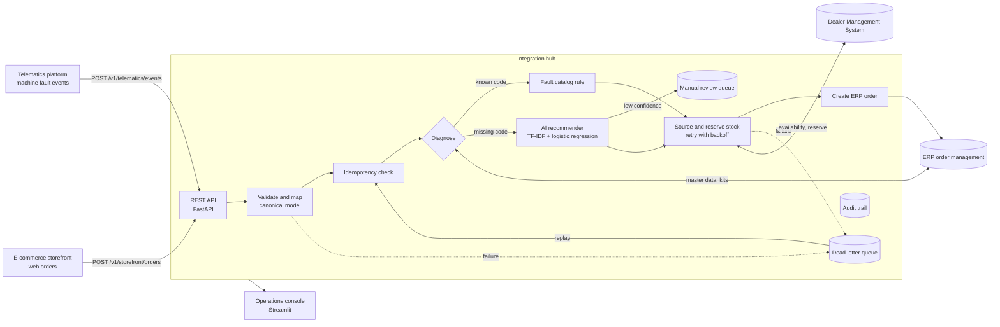
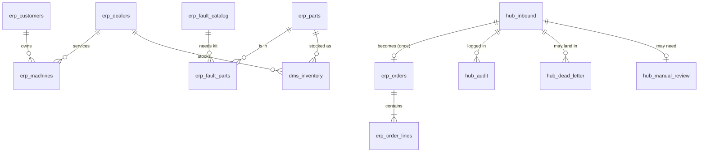
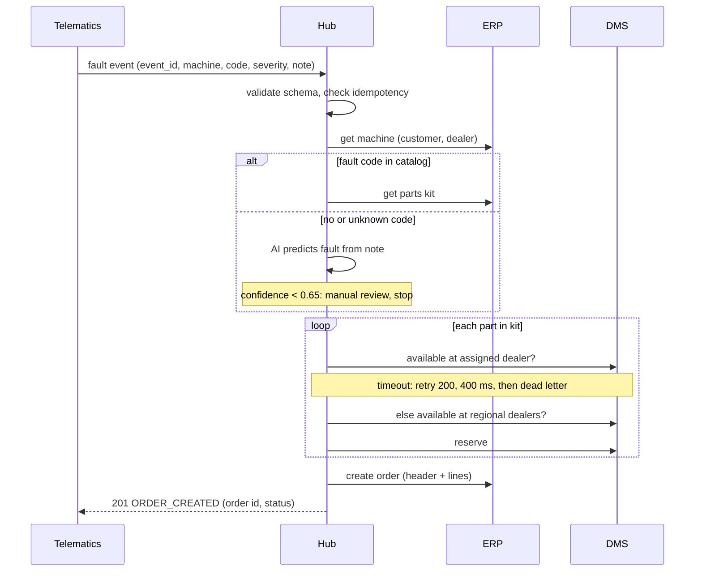

# 02 Solution Design

## 1. Architecture

## 2. Components

| Component | File | Responsibility |
|---|---|---|
| Canonical model | `hub/models.py` | One contract per message type. Source systems are mapped at the edge so the core never depends on one system's field names. |
| ERP connector | `hub/connectors.py` | Master data lookups, fault kits, price list, order creation. |
| DMS connector | `hub/connectors.py` | Stock availability and reservation. Simulates timeouts and outage windows. |
| AI recommender | `hub/recommender.py` | Predicts a fault from a free-text note, returns confidence and top 3. |
| Orchestration | `hub/service.py` | The business process, retries, transactions, dead letters, replay, audit. |
| REST API | `hub/api.py` | Inbound endpoints plus troubleshooting endpoints (trace, dead letters, replay, metrics). |
| Console | `app/console.py` | Operations dashboard and a form to send test events. |
| Configuration | `hub/config.py` | Every business threshold in one place (NFR-07). |

## 3. Logical data model

`erp_orders.source_message_id` is UNIQUE, so the database itself enforces one order per message (FR-11), in
addition to the hub's idempotency check.

## 4. Sequence: machine fault to ERP order

## 5. API contract

| Method | Path | Purpose | Responses |
|---|---|---|---|
| POST | `/v1/telematics/events` | Inbound fault event | 201 order created, 200 duplicate, 202 no action / review / dead letter, 422 rejected |
| POST | `/v1/storefront/orders` | Inbound web order | same as above |
| GET | `/v1/orders/{order_id}` | Order header and lines | 200, 404 |
| GET | `/v1/messages/{message_id}` | Status and full audit trail | 200, 404 |
| GET | `/v1/dead-letters` | Open (or all) dead letters | 200 |
| POST | `/v1/dead-letters/replay` | Reprocess replayable dead letters | 200 |
| GET | `/v1/metrics` | KPI summary | 200 |
| GET | `/health` | Liveness | 200 |

Interactive documentation is generated at `/docs` when the API is running.

## 6. Error handling matrix

| Failure | Detected by | Outcome | Replayable | Owner |
|---|---|---|---|---|
| Malformed payload | Schema validation | REJECTED, VALIDATION_FAILED | No | Sending system team |
| Same message sent again | Idempotency check | DUPLICATE, no new order | n/a | none |
| Machine or customer unknown | ERP lookup | DEAD_LETTER, MASTER_DATA_MISSING | Yes | Master data team |
| DMS timeout | Connector | Retry up to 3 times | n/a | none |
| DMS down after retries | Retry policy | DEAD_LETTER, DMS_UNAVAILABLE, transaction rolled back | Yes | Automatic replay |
| Part not in catalog | Price/part check | REJECTED, UNKNOWN_PART | No | E-commerce team |
| Price more than 1% off | Price check | DEAD_LETTER, PRICE_MISMATCH | No | Pricing team |
| AI not confident | Threshold rule | MANUAL_REVIEW | n/a | Service advisor |

## 7. Design decisions

**D1. Hub-and-spoke with a canonical model** instead of point-to-point connections. Four systems point-to-point
need up to 12 interfaces; through a hub each system needs one. Adding a fifth system (for example a field service app)
means one new adapter.

**D2. Idempotency at two layers.** The hub checks `hub_inbound`, and the database has a UNIQUE constraint on
`source_message_id`. Telematics platforms and browsers resend messages, so this is required, not optional.

**D3. All-or-nothing transaction per message.** Reservations and the order commit together or roll back together
(NFR-02). The audit trail is buffered and written after commit or rollback, so failed attempts are still logged.

**D4. Retry only transient errors.** Timeouts are retried with exponential backoff. Validation and business rule
failures are never retried because they would fail the same way every time.

**D5. Human in the loop for AI.** The model only creates orders above a confidence threshold. The threshold was
chosen from the precision versus coverage curve: 0.65 gives about 87% precision while auto-ordering about 71% of
AI cases. A wrong auto-order ships expensive parts to a job site, so precision matters more than coverage.

**D6. Simple, explainable model.** TF-IDF with logistic regression trains in seconds, gives calibrated probabilities
for the threshold rule, and its top words can be shown to a service advisor. A large language model could be swapped in
behind the same `predict()` interface later.

## 8. Security considerations
- All inputs validated by type and regular expression before touching any system (NFR-04).
- Every SQL statement is parameterized; a test scans the source to prevent string-formatted SQL.
- No credentials in code. In production, connector credentials would come from a secrets vault.
- Production additions: OAuth 2.0 client credentials on the API, TLS, rate limiting, and PII masking in logs.

## 9. Path to production

| This repo | Production equivalent (example) |
|---|---|
| FastAPI app | API gateway or API management in front of a containerized service |
| In-process processing | Message queue or event streaming (for example Kafka, Azure Service Bus, AWS SQS) |
| `hub_dead_letter` table | Native dead letter queue on the message broker |
| SQLite connectors | ERP and DMS APIs (REST, SOAP or IDoc) |
| `hub_audit` table | Centralized logging and tracing with correlation ids |
| GitHub Actions | CI/CD pipeline with test gates before deployment |
