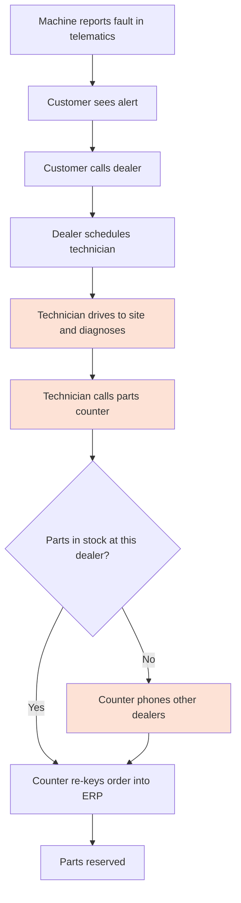
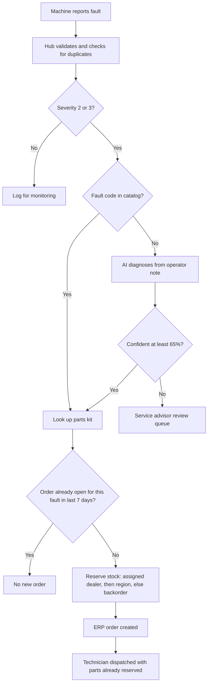
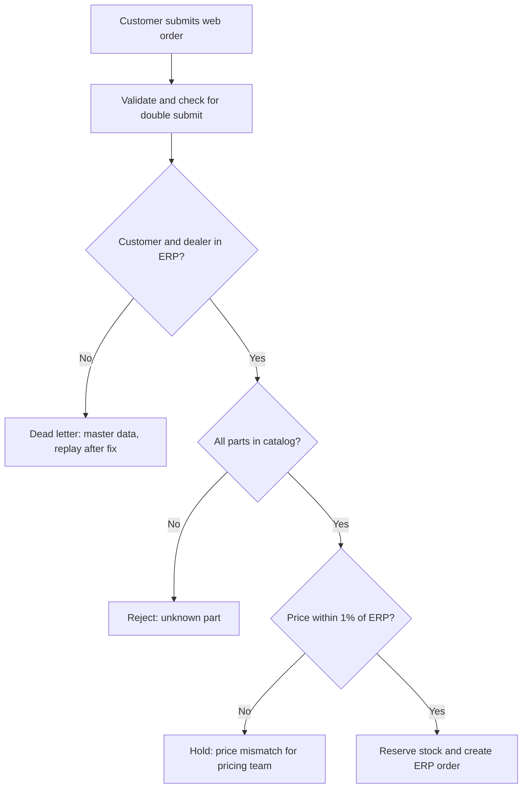
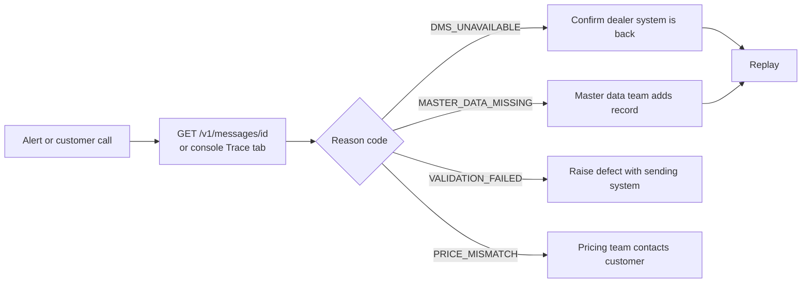

# 03 Process Flows

## Current state: machine fault to parts order (manual)

Pain points (shaded): waiting for a site visit before parts are ordered, phone calls to find stock, re-keying errors.
Estimated 30 hours from fault to parts reserved (assumption to validate).

## Future state: through the integration hub

## Future state: e-commerce order

## Support flow: a message failed

